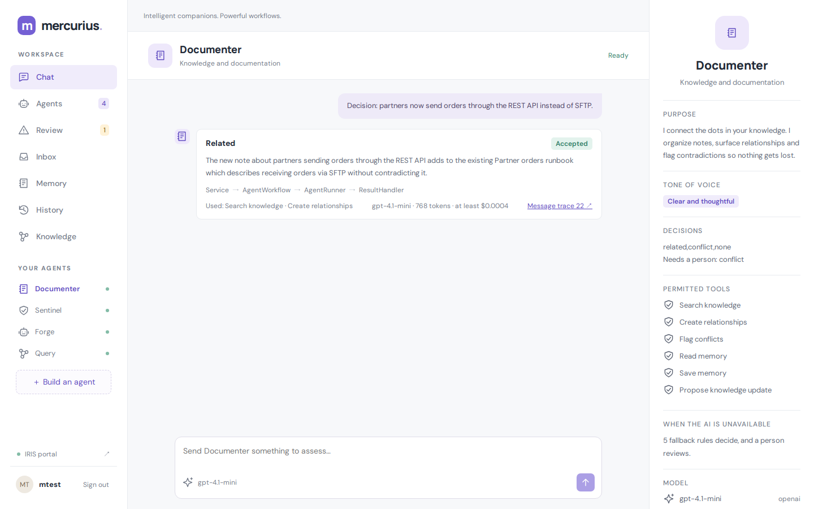
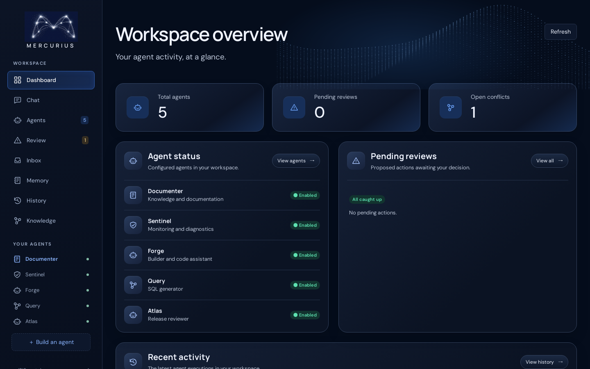
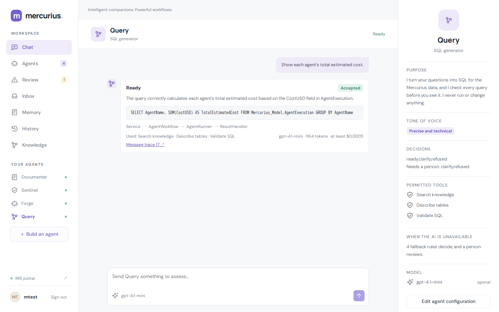
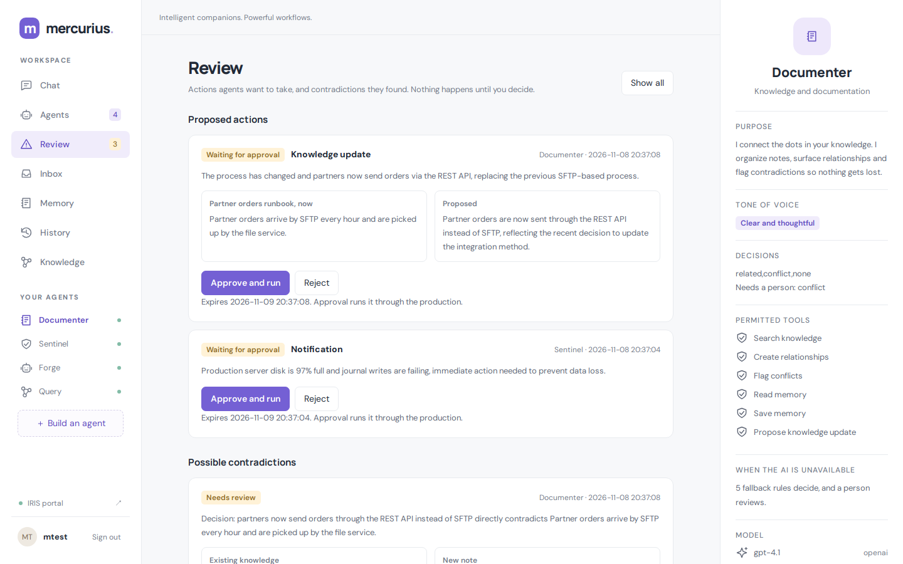
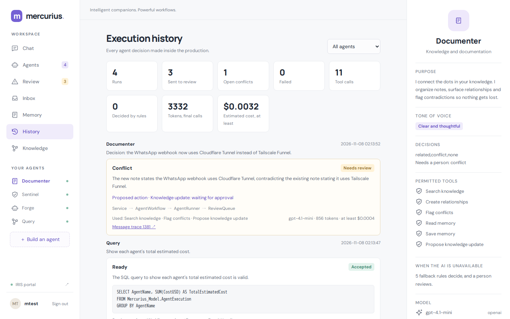
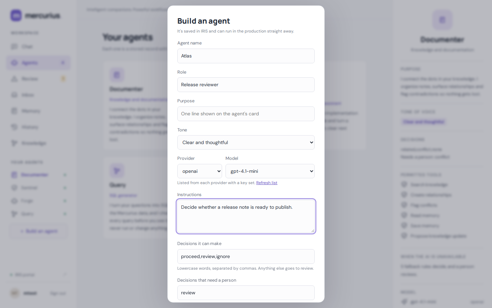
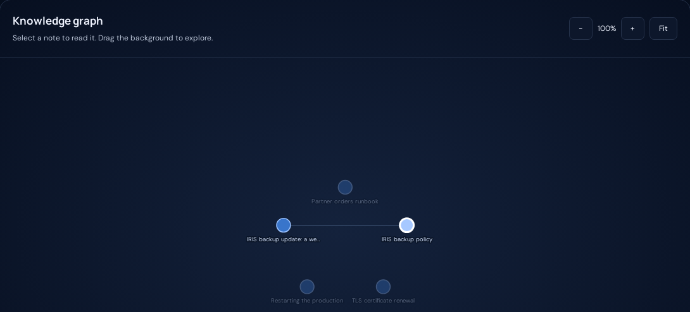

# Mercurius Agents

An AI operations desk for an InterSystems IRIS integration team, built on IRIS AI Hub and
Interoperability. Your team defines the agents; each one works inside a real production
and acts only with a person's approval.

**Live demo:** https://mercurius.juan-mota.com/mercurius/ (sign-in details for judges on request). It
resets nightly at 09:00 UTC and is capped at 400 AI runs a day.



## The problem

An integration team's knowledge drifts. A runbook still says partner orders arrive by SFTP
weeks after the team moved partners to a REST API. Alerts arrive faster than anyone
can rate them. Code reviews wait, and nobody knows what the AI tools cost.

## A day with Mercurius

| When | Agent | What happens |
|---|---|---|
| A new decision note is filed | **Documenter** | Finds the old runbook it contradicts, flags the conflict and proposes corrected text. A person approves, and the note is fixed through the production |
| A disk alert arrives | **Sentinel** | Checks known issues, rates it high and proposes a message for the person on call |
| A developer pastes a line | **Forge** | Compiles it without running it, checks it against the team's standards and names the broken rule |
| A lead asks "what did the agents cost?" | **Query** | Writes the SQL, validates it without running it, and shows it |
| A new need appears | **Build an agent** | Anyone with access creates a new agent in the UI, with its own decisions, tools and fallback rules. It runs in the production straight away, with no new class |

Agents are stored records, not generated classes. One runtime runs them all. Each agent has
its own instructions, model, permitted tools, private knowledge and memory.

**No OpenAI key?** The production still runs: each agent's fallback rules decide, the run is
labelled **Rules, not AI**, and it goes to review.

## How it works

```text
File inbox or web UI -> DocumentIngress / AlertIngress / CodeIngress / ChatIngress (BS)
                   |
             AgentWorkflow (BP) -> AgentRunner (BO) -> AI Hub agent + permitted tools
                   |
          validated decision routes the message
                   |
      +------------+------------+
      v                         v
 ResultHandler (BO)        ReviewQueue (BO)
```

| Deterministic code | AI judgment |
|---|---|
| Saving documents, checking tool permissions, enforcing ownership, validating the decision against allowed values, routing | Choosing search terms, comparing notes, proposing a decision |

An invalid or failed reply never gets accepted: it goes to review.

## What agents can do

| Capability | How |
|---|---|
| Decide | Every run ends in a decision from the agent's own list. Invalid replies go to review |
| Use tools | Search knowledge, link notes, flag conflicts, read and save memory, each granted per agent |
| Propose actions | Send a notification, or update a note. Nothing runs until a person approves it in **Review**; approval re-checks the proposal and runs it through the production |
| Keep working without AI | If there's no key or the provider fails, the agent's fallback rules decide. These runs are labelled **Rules, not AI** and always go to review |
| Check, not guess | Forge compiles code as a throwaway routine, which never runs it. Query prepares SQL without running it, only SELECT, only the `Mercurius_Model` schema |
| Choose their model | Each agent has its own provider and model, chosen from the provider's live list. Only providers with a key are offered |
| Show their cost | Each run records the model, tokens and an estimated cost |

## Screenshots

| | |
|---|---|
|  |  |
|  |  |
|  |  |

## Measured results

`Mercurius.Test.Eval` sends 55 labelled inputs through the production, with fresh sample
knowledge for each. On build 109, 2026-11-07 and 2026-11-08:

| Agent | Model | Correct | Search found the right note | Estimated cost, whole set |
|---|---|---|---|---|
| Documenter | gpt-4.1 | 13 of 15, twice | 10 of 10 | $0.028 |
| Sentinel | gpt-4.1-mini | 14 of 15 | n/a | $0.002 |
| Forge | gpt-4.1 | 14 of 15 | n/a | $0.021 |
| Query | gpt-4.1-mini | 8 of 10 | n/a | $0.005 |

- Forge went from 12 to 14 of 15 once it could compile code with `CheckSyntax`. On `gpt-4.1-mini` it scored 9 to 11, so it uses `gpt-4.1`.
- Query got every answerable question right: all five generated queries were also checked by hand. Its misses were a guess on a vague question, and "clarify" instead of "refused" for another schema.
- The inputs were written by the author, and model output varies between runs. Treat these as a smoke test, not a benchmark.
- Costs come from list prices and count only the final model call of each run, so they're lower bounds.
- Documenter: every conflict was caught in both runs. The two misses were the same both times: notes about failed-file handling and restore tests were judged unrelated to the runbook and backup policy, which is debatable. On `gpt-4.1-mini` it scored 12 to 15 of 15 depending on the run and the example notes, and sometimes missed the main demo conflict, so it uses `gpt-4.1`.
- Basic text search found the right note every time, so vector search isn't needed at this size.

Run it yourself:

```bash
echo 'Do ##class(Mercurius.Test.Eval).Run() Halt' | docker compose exec -T iris iris session IRIS -U IRISAPP
```

## Requirements

- Docker with Compose
- The **AI Hub Community** image, build `2027.1.0AI.109.0`, from the
  [EAP portal](https://evaluation.intersystems.com/Eval/early-access/AIHub).
  It can't be pulled from a registry, and this repo never publishes it.
- An **OpenAI** API key. Variable: `OPENAI_API_KEY`. The default model is `gpt-4.1-mini`.
- Optional: an **Anthropic** API key, `ANTHROPIC_API_KEY`. Each agent can then use a Claude model, chosen in the agent form.

## Install

Load the image and give it the short tag used by the Dockerfile:

```bash
docker image load -i iris-community-2027.1.0AI.109.0-docker.tar.gz
docker tag docker.iscinternal.com/docker-intersystems/intersystems/iris-community:2027.1.0AI.109.0 iris-community:2027.1.0AI.109.0
```

Clone, add your key and start:

```bash
git clone https://github.com/xJuan21/mercurius-agents.git
cd mercurius-agents
cp .env.example .env      # then put your key in .env
docker compose up -d --build
```

The build compiles the code, seeds the sample agents and sets the production to start
with IRIS.

### Install with IPM

On an IRIS AI Hub instance, build `2027.1.0AI.109.0`:

```objectscript
zpm "install mercurius-agents"
```

Then start the production, or restart IRIS:

```objectscript
Do ##class(Ens.Director).StartProduction("Mercurius.Interop.Production")
```

This installs the backend in the current namespace: agents, production, API and sign-in. The web UI is built by Docker,
so use the Docker install above for the full app. IRIS needs `OPENAI_API_KEY` in its
environment.

## Verify

```bash
docker compose ps                                                          # shows (healthy)
curl -s -o /dev/null -w '%{http_code}\n' http://localhost:52775/mercurius/   # 200
```

Backend checks, no LLM needed:

```bash
echo 'zpm "mercurius-agents test -only" Halt' | docker compose exec -T iris iris session IRIS -U IRISAPP
```

This writes test records, and `demo/run.sh` resets them.

## Sign in

Open http://localhost:52775/mercurius/ and sign in with an IRIS account. On a fresh local
build, that's `_SYSTEM` with the image's default password. To add a user, create it in the
portal and give it the `MercuriusUser` role.

## Use it

| Page | What it does |
|---|---|
| Chat | Sends a message through the production and shows the agent's decision, tools and trace |
| Dashboard | Agents, pending reviews, open conflicts and recent activity at a glance |
| Agents | Shows the agents. **Build an agent** creates a stored agent that runs immediately |
| Review | Approve or reject proposed actions, and resolve possible contradictions |
| Inbox | Notifications a person approved |
| Memory, Knowledge | Show what the selected agent holds privately. Knowledge has cards, a note reader and a graph of how notes connect |
| History | Shows every run, including those from the file services |

To send the sample events through the file services instead:

```bash
./demo/run.sh
```

LLM judgment varies between runs. The Management Portal is at
http://localhost:52775/csp/sys/UtilHome.csp, and each decision links to its message trace.

## Add an agent

Use **Build an agent** in the UI: no new class is needed. The runtime adds the reply format
from the agent's decision values. To drive an agent from a file service too, add a Business
Service item and set its `AgentName` setting.

## Web UI

The UI is an Angular app in `web/`, built in a separate Docker stage. IRIS serves the output.

| Path | Purpose |
|---|---|
| `web/src/app/core` | Sign-in, API access and shared state |
| `web/src/app/layout` | The main layout |
| `web/src/app/shared` | Reusable components |
| `web/src/app/features` | One folder per page |

Sign-in uses the JWT support built into IRIS REST web applications. IRIS checks the password
and provides `/login`, `/refresh` and `/logout`. The access token stays in memory, and the
refresh token stays in `sessionStorage`, so it ends with the browser tab.

## Contest bonuses

| Bonus | Where to see it |
|---|---|
| Docker | `Dockerfile` and `docker-compose.yml`: `docker compose up -d --build` |
| Online demo | https://mercurius.juan-mota.com/mercurius/, live with real models, added 2026-11-09 |
| IPM (ZPM) | `module.xml`: `zpm "install mercurius-agents"` installs the backend, and `zpm "mercurius-agents test"` runs the tests |
| AI Hub bugs | [ai-hub-eap-bugreports #25](https://github.com/intersystems-community/ai-hub-eap-bugreports/issues/25): a tool hidden by `%CanList` is rejected with no audit record. [#26](https://github.com/intersystems-community/ai-hub-eap-bugreports/issues/26): `iris-main` aborts with exit 134 when the working directory isn't writable |

## Credits

Copyright (c) 2026 Juan Mota Sanchez. Released under the [MIT License](LICENSE).

Forge's review checklist comes from the `objectscript-review` skill in
[iris-agentic-dev](https://github.com/intersystems-community/iris-agentic-dev) (InterSystems,
MIT License). Built on the [ai-hub-dev-template](https://github.com/intersystems-community/ai-hub-dev-template).

## Why not `EnsLib.AI.Agent.PassthroughOperation`?

IRIS ships an experimental operation and adapter for calling an agent from a production.
We tested them on build 109 and kept our own `AgentRunner` operation.

| | `EnsLib.AI.Agent.*` | `AgentRunner` |
|---|---|---|
| Agent configuration | Built once per production item, at startup | Loaded from a stored record on each message |
| Agents per item | One | Any |
| Per-agent tool identity | Not with settings alone: `AuthPolicy` is created with a bare `%New()` | Set by the runtime |
| A failed LLM call | Message error | Recorded result, routed to review |
| Message trace | Persistent `LLMResponse` with usage | Our own message classes |

Subclassing the adapter and using its `OnAfterAgentInit` hook does give per-agent tools,
so it's a possible later direction once the classes are no longer experimental.

## Hosting a public demo

- Set `MERCURIUS_DAILY_AI_LIMIT` in `.env` to cap AI runs per day; over the limit, fallback rules decide.
- Expose only `/mercurius/` through your reverse proxy or tunnel, never the Management Portal. Set `MERCURIUS_PORTAL_LINKS=0` so the UI shows trace session numbers without links into the private portal.
- Change the image's default passwords, and give visitors a user with only the `MercuriusUser` role.
- Reset nightly: `echo 'Do ##class(Mercurius.Setup).ResetDemo() Halt' | docker compose exec -T iris iris session IRIS -U IRISAPP`

## Security

- The runtime binds each tool to its agent, so the LLM never supplies the agent's identity.
- `Mercurius.Runtime.ToolPolicy` checks every tool against the agent's grants, and
  ungranted tools aren't shown to the LLM.
- `KnowledgeService` enforces ownership, so relationships can't cross agents.
- Every tool call is audited in `Mercurius.Model.AgentToolCall`.
- Agents get no SQL, filesystem or shell tools.
- The API requires a token, and users need the `MercuriusAccess` resource. `/mercurius/` serves only the built web files.
- Use HTTPS or a private network: passwords are sent at sign-in.

## Gotchas found on build 109

| Symptom | Cause | Fix |
|---|---|---|
| Container restarts with exit 134: `Unable to find/open file iris-main.log` | The repo is bind-mounted over the working directory, and the IRIS user can't write there | `working_dir: /home/irisowner` in `docker-compose.yml` |
| `<PRIVATE METHOD>` from `ToolManager.AddToolSetInstance()` | The method is private | Use `ToolManager.AddTool(instance)`, which keeps instance properties through `Chat()` |
| A tool hidden by `%CanList` isn't audited when called | The call fails as `ToolNotFound`, before `%CanExecute` and `%LogDenial` | Also check permissions in your own services |
| A static web application returns 404 at its root | It has no default document | Serve `index.html` from a small dispatch class, as `Mercurius.API.Web` does |
| Every `%CSP.REST` route returns the same output | A method named `Page` overrides `%CSP.Page` | Use another method name |

## Known limitations

- Knowledge search is basic text matching, so related notes can be missed.
- A conflict is an AI finding, not a verified fact.
- Approved notifications go to the in-app inbox. To deliver them elsewhere, point the `NotifyTarget` setting of `ActionIngress` at another operation.
- An LLM call that hangs has no timeout of its own.
- API keys are redacted from stored errors. Other sensitive text in an error is not.
- Chat shows decisions, not free conversation.
- Agents can be disabled but not deleted from the UI.
- AI Hub is pre-release software.
